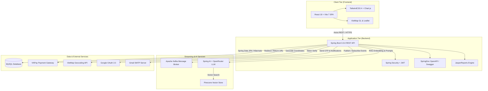

# 🏥 Hệ Thống Đặt Lịch Khám Bệnh & Quản Lý Phòng Khám Trực Tuyến (Medical Appointment System)

<div align="center">


<p align="center">
  <b>Nền tảng y tế số toàn diện tích hợp Trợ lý Trí tuệ Nhân tạo (Spring AI / LLM RAG), Bản đồ số VietMap, Cổng thanh toán trực tuyến VNPay, và Kiến trúc sự kiện Apache Kafka.</b>
</p>

[Tính Năng Chính](#-tính-năng-nổi-bật) •
[Công Nghệ](#-công-nghệ-sử-dụng) •
[Kiến Trúc](#-kiến-trúc-hệ-thống) •
[Cài Đặt & Khởi Chạy](#-hướng-dẫn-cài-đặt--khởi-chạy) •
[Báo Cáo Tổng Quan (Markdown)](docs/TONG_QUAN_VA_TINH_NANG_DU_AN.md) •
[Báo Cáo Word (.docx)](docs/TONG_QUAN_VA_TINH_NANG_DU_AN.docx) •
[Tài Khoản Demo](#-tài-khoản-thử-nghiệm-demo)

</div>

---

## 🚀 Công Nghệ Sử Dụng

### 🖥️ Backend (Spring Boot Ecosystem)
[](https://www.oracle.com/java/)
[](https://spring.io/projects/spring-boot)
[](https://spring.io/projects/spring-security)
[](https://jwt.io/)
[](https://spring.io/projects/spring-data-jpa)
[](https://www.mysql.com/)
[](https://kafka.apache.org/)
[](https://swagger.io/)
[](https://community.jaspersoft.com/)

### 🎨 Frontend (Modern Web & React)
[](https://react.dev/)
[](https://vitejs.dev/)
[](https://tailwindcss.com/)
[](https://reactrouter.com/)
[](https://www.chartjs.org/)
[](https://fontawesome.com/)

### 🤖 AI, Bản Đồ & Dịch Vụ Mở Rộng
[](https://spring.io/projects/spring-ai)
[](https://www.pinecone.io/)
[](https://vietmap.vn/)
[](https://vnpay.vn/)
[](https://developers.google.com/identity)
[](https://mail.google.com/)

---

## ✨ Tính Năng Nổi Bật

### 🧑‍⚕️ 1. Dành cho Bệnh Nhân (Patient Portal)
- 🔍 **Tìm kiếm bác sĩ & Chuyên khoa:** Tra cứu bác sĩ theo chuyên khoa, tên, đánh giá, chi phí khám và số năm kinh nghiệm.
- 🗺️ **Định vị & Bản đồ số thông minh (VietMap):**
  - Tự động Geocode địa chỉ phòng khám thành tọa độ kinh độ/vĩ độ.
  - Tính toán khoảng cách thực tế giữa bệnh nhân và phòng khám (Haversine formula).
  - Bản đồ tương tác trực quan với VietMap GL JS & Leaflet.
- 🤖 **Trợ lý Y tế AI (AI Medical Assistant & Symptom Checker):**
  - Trò chuyện y tế 24/7 giải đáp thắc mắc về sức khỏe với ngữ cảnh lưu trữ theo phiên (`ConversationMemory`).
  - Gợi ý bác sĩ phù hợp nhất dựa trên mô tả triệu chứng và vị trí địa lý của bệnh nhân (OpenRouter / Spring AI RAG).
- 📅 **Đặt lịch khám linh hoạt:**
  - Chọn bác sĩ, ngày khám và khung giờ thực tế có thể đặt (`BookableSlot`).
  - Xem ghi chú, lý do khám và xác nhận đặt lịch tức thì.
- 💳 **Thanh toán trực tuyến VNPay:**
  - Tích hợp cổng thanh toán VNPay Sandbox với mã QR, thẻ ATM nội địa, Internet Banking và thẻ Quốc tế.
  - Tự động xác thực giao dịch qua IPN và điều hướng trang kết quả giao dịch.
- 📜 **Lịch sử & Quản lý lịch hẹn:**
  - Theo dõi trạng thái lịch hẹn (`Chờ duyệt`, `Đã xác nhận`, `Đã khám`, `Đã hủy`).
  - Dời lịch hoặc hủy lịch khám nhanh chóng.
- 🔐 **Xác thực an toàn:**
  - Đăng ký, đăng nhập tài khoản bệnh nhân với mã hóa mật khẩu BCrypt.
  - Đăng nhập 1 chạm với **Google OAuth 2.0**.
  - Quên mật khẩu & gửi mã token xác thực qua **Gmail SMTP**.

---

### 👨‍⚕️ 2. Dành cho Bác Sĩ (Doctor Portal)
- 📊 **Dashboard Phân tích & Thống kê trực quan:**
  - Thống kê lịch hẹn trong ngày, lịch hẹn sắp tới, lịch bị nhỡ.
  - Biểu đồ tròn tỷ lệ trạng thái lịch hẹn (`PieChart`).
  - Biểu đồ kết hợp theo dõi doanh thu và số lượng lượt khám 12 tháng trong năm (`CombinationChart`).
- 📋 **Quản lý Lịch hẹn bệnh nhân:**
  - Xem danh sách lịch hẹn chi tiết của bệnh nhân.
  - Thực hiện các thao tác: **Xác nhận lịch**, **Bắt đầu khám**, **Từ chối / Hủy lịch** (tự động hoàn tiền và cập nhật slot).
- ⏰ **Quản lý Lịch làm việc & Khung giờ khám:**
  - Cấu hình ca làm việc trong tuần theo thứ (`DoctorAvailability`).
  - Tự động sinh danh sách ca khám mở cho bệnh nhân đặt lịch (`BookableSlot`).
- 📄 **Xuất Hồ Sơ & Phiếu Khám Bệnh (JasperReports PDF):**
  - Xuất phiếu khám bệnh chi tiết định dạng PDF chuyên nghiệp với mã lịch hẹn, thông tin bệnh nhân, bác sĩ và chi phí.
- 🔔 **Hệ thống Thông báo thời gian thực:**
  - Nhận thông báo tức thì khi có bệnh nhân đặt lịch hoặc thay đổi lịch hẹn.
  - Đánh dấu đã đọc và theo dõi số lượng thông báo chưa đọc.
- 👤 **Quản lý Hồ sơ bác sĩ:**
  - Cập nhật thông tin chuyên khoa, giới thiệu tiểu sử (Bio), địa chỉ phòng khám, giá khám và đổi mật khẩu an toàn.

---

### ⚡ 3. Kiến Trúc & Xử Lý Bất Đồng Bộ
- **Apache Kafka Message Broker:** Xử lý luồng sự kiện đặt lịch, hủy lịch và kích hoạt các tác vụ gửi thông báo ngầm, đảm bảo hệ thống chịu tải cao và không bị nghẽn (loose coupling).
- **Pinecone Vector Database & RAG:** Lưu trữ và truy vấn vector embeddings thông tin chuyên gia y tế, giúp hệ thống AI trả về gợi ý chính xác theo ngữ cảnh y khoa.

---

## 🏛️ Kiến Trúc Hệ Thống



---

## 📂 Cấu Trúc Dự Án

```bash
medical-appointment/
├── backend/                               # Spring Boot Backend API (Java 21)
│   ├── src/main/java/com/example/j2ee_backend/
│   │   ├── config/                        # SecurityConfig, KafkaConfig, AiConfig...
│   │   ├── controller/                    # REST Controllers (Patient, Doctor, Appointment, AI, Payment...)
│   │   ├── dto/                           # Data Transfer Objects
│   │   ├── entity/                        # JPA Entities (Appointment, Doctor, Patient, Slot...)
│   │   ├── repository/                    # Spring Data JPA Repositories
│   │   ├── service/                       # Business Logic (VietMap Geocode, AI, Payment, Kafka...)
│   │   └── exception/                     # Global Exception Handling
│   ├── src/main/resources/
│   │   ├── application.properties.example # File mẫu cấu hình Database, API Keys, Mail
│   │   ├── reports/                       # File template JasperReports (.jrxml)
│   │   └── fonts/                         # Phông chữ hỗ trợ Tiếng Việt cho PDF
│   └── pom.xml                            # Maven dependencies configuration
│
├── frontend/                              # React 19 Frontend SPA (Vite + TailwindCSS)
│   ├── src/
│   │   ├── component/                     # Header, NavBar, Footer, Reusable UI
│   │   ├── context/                       # PatientContext, DoctorContext
│   │   ├── hook/                          # Custom React Hooks (useFetch...)
│   │   ├── page/
│   │   │   ├── auth/                      # Login, Register, Forgot/Reset Password
│   │   │   ├── doctor/                    # Dashboard, Schedule, Appointments, Reports
│   │   │   ├── patient/                   # Home, DoctorList, Booking, AI Suggest, Payment
│   │   │   └── layout/                    # DoctorLayout, PatientLayout
│   │   ├── service/                       # API Services (Axios wrappers)
│   │   ├── App.jsx                        # Main component
│   │   └── main.jsx                       # Routing setup & React root
│   ├── package.json
│   └── vite.config.js
│
└── database/
    └── dat_lich_kham_benh.sql             # Script khởi tạo cơ sở dữ liệu MySQL đầy đủ mẫu dữ liệu
```

---

## 🛠️ Hướng Dẫn Cài Đặt & Khởi Chạy

### 1. Yêu Cầu Môi Trường (Prerequisites)
- **Java:** JDK 21 trở lên (khuyến nghị OpenJDK hoặc Oracle JDK 21)
- **Node.js:** v18.x hoặc v20.x trở lên
- **MySQL:** 8.0 trở lên hoặc MariaDB 10.4+
- **Apache Kafka (Tùy chọn cho tính năng event streaming):** v3.x+
- **Maven:** 3.9+ (hoặc dùng trực tiếp `./mvnw` đi kèm)

---

### 2. Thiết Lập Cơ Sở Dữ Liệu (MySQL)
1. Khởi động dịch vụ MySQL của bạn (qua XAMPP, Docker hoặc dịch vụ máy chủ).
2. Tạo database và import file SQL mẫu:
```bash
# Cách 1: Sử dụng terminal mysql
mysql -u root -p < database/dat_lich_kham_benh.sql

# Cách 2: Hoặc mở phpMyAdmin / MySQL Workbench / DBeaver, tạo database `dat_lich_kham_benh` và Import file `database/dat_lich_kham_benh.sql`
```

---

### 3. Cấu Hình & Chạy Backend (Spring Boot)

1. Di chuyển vào thư mục backend:
```bash
cd backend
```

2. Tạo file `application.properties` từ file mẫu:
```bash
cp src/main/resources/application.properties.example src/main/resources/application.properties
```

3. Mở file `src/main/resources/application.properties` và điều chỉnh các thông số phù hợp:
```properties
# Cấu hình kết nối MySQL
spring.datasource.url=jdbc:mysql://localhost:3306/dat_lich_kham_benh?useSSL=false&serverTimezone=UTC&characterEncoding=UTF-8
spring.datasource.username=root
spring.datasource.password=your_mysql_password

# Cấu hình VNPAY Sandbox (Đã có sẵn cấu hình test)
vnpay.payUrl=https://sandbox.vnpayment.vn/paymentv2/vpcpay.html
vnpay.returnUrl=http://localhost:5173/patient/payment_result
vnpay.tmnCode=1EYU51QY
vnpay.hashSecret=ZD91OBTG746BP5LJXD80MWXVO2BSFJDX

# Cấu hình Email gửi thông báo / OTP
spring.mail.username=your_email@gmail.com
spring.mail.password=your_app_password

# Cấu hình Spring AI (OpenRouter / OpenAI)
spring.ai.openai.api-key=your_openrouter_api_key

# Cấu hình VietMap API
vietmap.apiKey=your_vietmap_api_key
```

4. Khởi chạy ứng dụng Backend:
```bash
# Trên macOS / Linux:
./mvnw clean spring-boot:run

# Trên Windows:
mvnw.cmd clean spring-boot:run
```
> 🌐 Backend API sẽ khởi chạy tại: **`http://localhost:8080`**

---

### 4. Cấu Hình & Chạy Frontend (React + Vite)

1. Mở một cửa sổ terminal mới và di chuyển vào thư mục frontend:
```bash
cd frontend
```

2. Cài đặt các gói thư viện dependencies:
```bash
npm install
```

3. (Tùy chọn) Cấu hình Google OAuth Client ID trong file `.env` nếu muốn sử dụng Google Login:
```env
VITE_GOOGLE_CLIENT_ID=your_google_client_id.apps.googleusercontent.com
```

4. Khởi chạy máy chủ phát triển Vite:
```bash
npm run dev
```

> 🚀 Frontend sẽ khởi chạy tại: **`http://localhost:5173/`**  
> *(Hệ thống tự động chuyển hướng về trang chủ bệnh nhân: `http://localhost:5173/patient`)*

---

## 👥 Tài Khoản Thử Nghiệm (Demo)

Dữ liệu mẫu trong database đã thiết lập sẵn các tài khoản thử nghiệm với mật khẩu mặc định là: **`123456`**

| Vai Trò | Email Đăng Nhập | Mật Khẩu Mặc Định | Mô Tả / Ghi Chú |
|:---|:---|:---:|:---|
| 👨‍⚕️ **Bác sĩ** | `bs.a@example.com` | `123456` | BS. Nguyễn Văn A - Chuyên khoa Tim Mạch |
| 👨‍⚕️ **Bác sĩ** | `bs.b@example.com` | `123456` | BS. Trần Thị B - Khám Nội Tổng Quát |
| 👨‍⚕️ **Bác sĩ** | `bs.c@example.com` | `123456` | BS. Lê Văn C - Tai Mũi Họng |
| 👨‍⚕️ **Bác sĩ** | `bs.d@example.com` | `123456` | BS. Phạm Thị D - Da Liễu & Thẩm Mỹ |
| 🧑‍🦱 **Bệnh nhân** | `long@example.com` | `123456` | Nguyễn Văn Long - Đã có lịch sử đặt khám |
| 🧑‍🦱 **Bệnh nhân** | `huong@example.com` | `123456` | Trần Thị Hương |

- **Cổng Đăng nhập Bệnh nhân:** `http://localhost:5173/patient/login`
- **Cổng Đăng nhập Bác sĩ:** `http://localhost:5173/doctor`

---

## 📑 Tài Liệu API (Swagger)

Sau khi khởi chạy Backend, truy cập trực tiếp Swagger UI tương tác để kiểm thử toàn bộ API endpoints:

📍 **Swagger UI Link:** [http://localhost:8080/swagger-ui/index.html](http://localhost:8080/swagger-ui/index.html)

### Bảng Tóm Tắt Một Số API Chính:
| Nhóm API | Phương Thức | Endpoint | Chức Năng |
|:---|:---:|:---|:---|
| **Auth & Patient** | `POST` | `/api/patient/login` | Đăng nhập bệnh nhân |
| | `POST` | `/api/patient/register` | Đăng ký tài khoản bệnh nhân |
| | `POST` | `/api/patient/forgot_password` | Gửi email yêu cầu đặt lại mật khẩu |
| | `PUT` | `/api/patient/update/{id}` | Cập nhật hồ sơ bệnh nhân |
| **Doctor** | `POST` | `/api/doctor/login` | Đăng nhập bác sĩ |
| | `POST` | `/api/doctor/google-login` | Đăng nhập bác sĩ bằng Google Token |
| | `GET` | `/api/doctor/all` | Lấy danh sách tất cả bác sĩ |
| | `GET` | `/api/doctor/nearby` | Tìm bác sĩ gần nhất theo tọa độ & bán kính |
| | `POST` | `/api/doctor/{docId}/appointments/{aptId}/action` | Bác sĩ xác nhận / bắt đầu / từ chối lịch |
| **Appointments** | `POST` | `/api/appointment/save` | Đặt lịch khám bệnh mới |
| | `GET` | `/api/appointment/doctor/{doctorId}` | Xem lịch hẹn theo bác sĩ |
| | `GET` | `/api/appointment/patient/{patientId}` | Xem lịch sử hẹn của bệnh nhân |
| | `PUT` | `/api/appointment/reschedule/{id}` | Dời ngày / giờ khám |
| **AI Assistant** | `POST` | `/api/ai/suggest-doctors` | Gợi ý bác sĩ thông minh từ triệu chứng |
| | `POST` | `/api/ai/chat` | Trò chuyện tư vấn sức khỏe 24/7 |
| **Payment & Report** | `GET` | `/api/appointment/payment/result` | Xử lý phản hồi kết quả thanh toán VNPay |
| | `GET` | `/api/report/appointment/{id}` | Xuất phiếu khám bệnh PDF (JasperReports) |

---

## 🤝 Đóng Góp (Contributing)

Mọi đóng góp nhằm hoàn thiện dự án đều rất được hoan nghênh:
1. Fork dự án
2. Tạo nhánh tính năng mới (`git checkout -b feature/AmazingFeature`)
3. Commit các thay đổi (`git commit -m 'feat: Add some AmazingFeature'`)
4. Push lên branch của bạn (`git push origin feature/AmazingFeature`)
5. Mở một Pull Request

---

## 📄 Bản Quyền (License)

Dự án được phân phối dưới giấy phép **MIT License**. Chi tiết xem tại file `LICENSE`.

<div align="center">
  <sub>Xây dựng với cả tấm huyết dành cho Đồ án Chuyên ngành Công Nghệ Thông Tin 🩺💻</sub>
</div>
